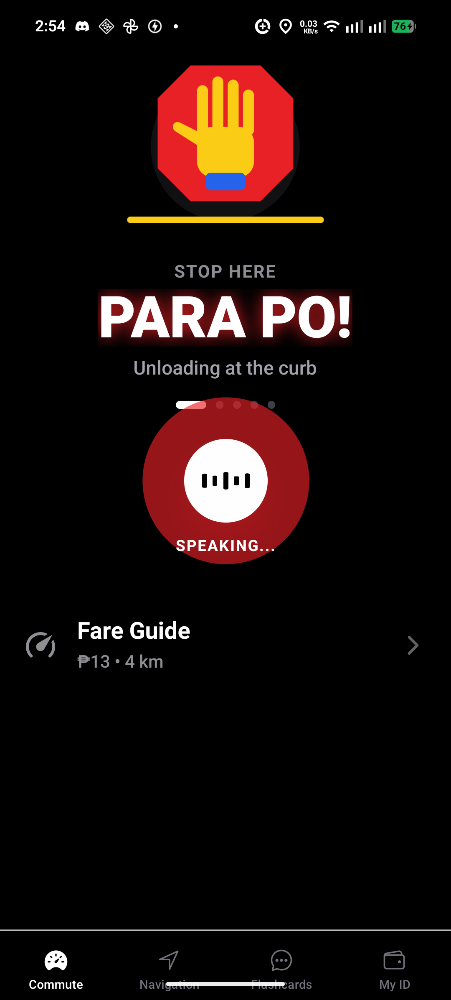
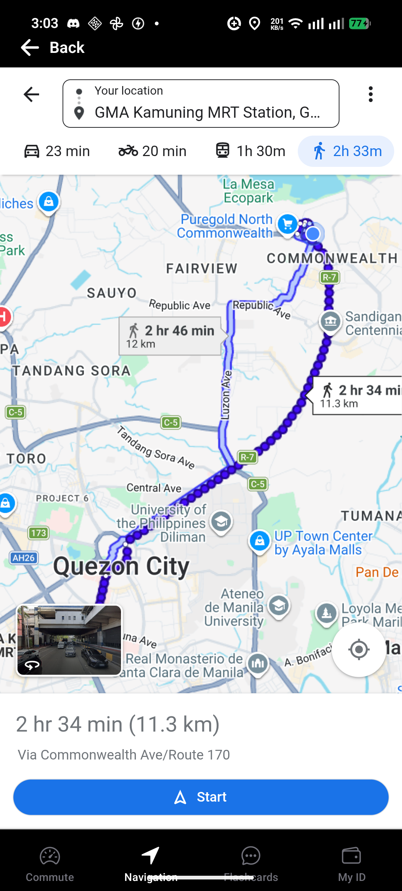
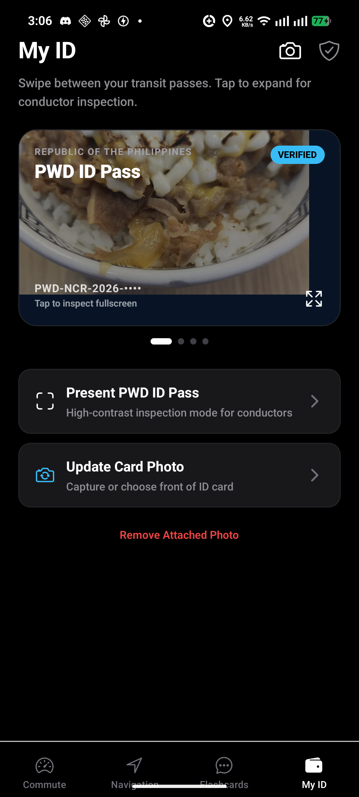

# ParaPo! 🚍✨

> **Mobile-First Accessible Commuter Companion for Filipino Commuters & PWDs**  
> Designed with a Tesla-inspired minimalist canvas, animated commuter flashcards, ChatGPT-inspired Voice Mode orb, local natural Filipino text-to-speech, Google Maps transit navigation, and Google Wallet-style digital discount passes.

---

## 📱 Visual Showcase

<div align="center">
  <table>
    <tr>
      <td align="center" width="25%">
        
        <br />
        <b>Commute & Voice Glow</b>
      </td>
      <td align="center" width="25%">
        
        <br />
        <b>Transit Navigation & Directions</b>
      </td>
      <td align="center" width="25%">
        
        <br />
        <b>Flashcards & Voice Models</b>
      </td>
      <td align="center" width="25%">
        
        <br />
        <b>My ID (Wallet Carousel)</b>
      </td>
    </tr>
  </table>
</div>

---

## 📌 Table of Contents

1. [About The Project](#-about-the-project)
2. [Key Features](#-key-features)
3. [Architecture & Tech Stack](#-architecture--tech-stack)
4. [Project Structure](#-project-structure)
5. [Getting Started](#-getting-started)
    - [Prerequisites](#prerequisites)
    - [Installation](#installation)
    - [Running Development](#running-development)
    - [Building Standalone Release APK](#building-standalone-release-apk)
6. [UI/UX & Design Philosophy](#-uiux--design-philosophy)
7. [Contributing](#-contributing)
8. [Authors](#-authors)
9. [Version History](#-version-history)
10. [License](#-license)

---

## 📖 About The Project

Public transport in the Philippines (jeepneys, modern PUVs, UV Express, and buses) relies heavily on verbal cues (*"Para po!"*, *"Bayad po!"*, *"Sukli po!"*) and fast-paced curbside interactions. For **Persons with Disabilities (PWDs)**—particularly deaf, hard-of-hearing, speech-impaired, or mobility-challenged commuters—navigating public transport can be stressful and exclusionary.

**ParaPo!** bridges this accessibility barrier. Built with an unboxed, high-contrast dark aesthetic inspired by modern automotive software, ParaPo! combines:
- **Instant Full-Bleed Animated Visual Cards** to show drivers and passengers what you need from across the vehicle with zero visual clutter.
- **Local Natural Filipino Text-to-Speech** with prosody-normalized Filipino pronunciation and inclusive voice personalities.
- **ChatGPT Voice Mode Orb** featuring pulsing 5-bar waveforms, tactile heavy haptic feedback, and glowing uppercase text highlights.
- **In-App Google Maps Navigation** with automated GPS location centering, route mode selectors (Drive, Two-wheeler, Transit, Walk), and hardware back-gesture guards.
- **LTFRB Fare Guide & Offline Calculator** providing accurate fare computation for PUJs, Modern PUVs, and UV Express with statutory -20% PWD/Senior/Student discounts.
- **"My ID" Google Wallet-Style Digital Pass Carousel** with horizontal snapping cards, verified statutory discount badges, local photo storage, and fullscreen inspector modal with double-tap zoom and rotation.

---

## 🚀 Key Features

### 🎴 1. Visual Commuter Flashcards & Animated Scenes
- **Original Geometric Flat-Vector Art:** Context-specific animations tailored to Filipino commuter interactions:
  - 🛑 **`PARA PO!` (`stop`):** Raised yellow open hand gesture inside a red stop octagon with roadside markers.
  - 💵 **`BAYAD PO!` (`payment`):** Crisp Philippine Peso banknote (`₱`) and sliding gold coins with animated motion chevrons.
  - 🪪 **`PWD / SENIOR` (`discount`):** Verified commuter pass card with an avatar and bold `-20%` discount badge.
  - 🪙 **`SUKLI PO!` (`change`):** Three Peso coins (`₱10`, `₱5`, `₱1`) dropping into an open receiving hand.
  - 🚏 **`SA TABI LANG!` (`curbside`):** Sleek commuter vehicle pulling up to a curbside pin and crosswalk.
- **Targeted Glow Ergonomics:** Vector illustrations stay crisp and flat with zero ambient background glare, while the speaking text (`PARA PO!`, `BAYAD PO!`) and voice orb radiate a vibrant accent glow during speech.
- **Fullscreen Takeover:** Tap any flashcard to launch a high-contrast, maximum-readability full-screen view readable from across the vehicle.

### 🎙️ 2. ChatGPT Voice Mode Orb & Natural Filipino TTS
- **Interactive Voice Orb:** Large touch surface morphing into a glowing, pulsing sphere with 5 animated waveform bars when speaking.
- **Natural Filipino Local Engine:** Uses on-device neural TTS engines (`fil` locale with intelligent phoneme prosody mapping) that runs 100% offline and free on modern mobile devices.
- **Generic Inclusive Voice Profiles:**
  - `Voice 1` – Easygoing and versatile (Default)
  - `Voice 2` – Bright and expressive
  - `Voice 3` – Confident and clear

### 🗺️ 3. Full-Bleed In-App Transit Navigation
- **Native Google Maps UX:** Fully interactive map canvas initialized directly to user's current GPS location without redundant top black input boxes.
- **Interactive Direction Drawers:** Access route directions for Driving, Two-wheelers, Public Transit, and Walking directly inside the app.
- **Smart Intent & Protocol Routing:** Intercepts Google Maps `intent://`, `maps.app.goo.gl`, and `comgooglemapsurl://` calls, seamlessly converting place cards and navigation requests into in-webview Directions routes without getting trapped in app stores.
- **Google Sign-In Escape Guard:** Tapping "Save" automatically displays a prominent `"← Back to Google Maps (Skip Sign-In)"` banner, and connects to the Android hardware back gesture so users are never stuck in login redirects.

### 💰 4. LTFRB Fare Guide & In-App Matrix
- **Instant Local Fare Calculator:** Computes exact fares based on vehicle type (Traditional Jeepney, Modern PUJ, UV Express) and distance.
- **Statutory Discount Toggle:** One-tap 20% discount calculation for PWDs, Seniors, and Students.
- **Official LTFRB Rate Table Modal:** Embedded webview for inspecting the latest published fare matrices directly from the Land Transportation Franchising and Regulatory Board.

### 🛡️ 5. "My ID" Google Wallet Pass Carousel
- **Horizontal Swiping Pass Carousel:** Inspired by Google Wallet, commuters swipe smoothly between multiple transit discount cards:
  - PWD ID Pass (RA 7277 / 9442)
  - Senior Citizen Pass (RA 9994)
  - Student Commuter ID (RA 11314)
  - National ID / PhilSys Pass
- **Encrypted Local Storage:** ID card photos are stored privately in `FileSystem.documentDirectory` and persist across reboots via `AsyncStorage`.
- **Fullscreen Inspection Mode:** Tap any card to open a high-contrast inspection sheet with double-tap zoom, pinch-to-zoom, and a 90° landscape rotation button for conductors.

---

## 🛠️ Architecture & Tech Stack

| Domain | Technology / Library | Description |
| :--- | :--- | :--- |
| **Framework** | [React Native 0.79](https://reactnative.dev/) | Cross-platform native mobile runtime |
| **Toolchain** | [Expo SDK 54](https://expo.dev/) | Modern tooling with New Architecture (Bridgeless) |
| **Routing** | [Expo Router 4](https://docs.expo.dev/router/introduction/) | Typed file-based routing with tab layouts |
| **Styling** | [NativeWind v4](https://www.nativewind.dev/) (Tailwind CSS 3.4) | Utility-first styling optimized for React Native |
| **Animations** | [React Native Reanimated 3](https://docs.swmansion.com/react-native-reanimated/) | 60+ FPS native-thread vector and spring animations |
| **Speech (TTS)** | [Expo Speech](https://docs.expo.dev/versions/latest/sdk/speech/) | Local neural text-to-speech with prosody normalization |
| **Haptics** | [Expo Haptics](https://docs.expo.dev/versions/latest/sdk/haptics/) | Sensory tactile feedback on card taps and speech |
| **Location** | [Expo Location](https://docs.expo.dev/versions/latest/sdk/location/) | Geolocation and reverse geocoding for commuter origin |
| **Web & Maps** | [React Native WebView](https://github.com/react-native-webview/react-native-webview) | Embedded Google Maps and LTFRB browser with intent routing |
| **ID Viewer** | [React Native Image Pan Zoom](https://github.com/ascoders/react-native-image-zoom) | High-performance interactive ID zoom viewer |

---

## 📂 Project Structure

```text
parapo/
├── android/                 # Bare Android native project configuration & Gradle scripts
├── app/                     # Expo Router file-based screens
│   ├── (tabs)/
│   │   ├── _layout.tsx      # Dark minimalist bottom tab navigation
│   │   ├── index.tsx        # Commute Home: Flashcard carousel, VoiceOrb, Fare Guide
│   │   ├── WebMapTab.tsx    # Navigation: Full-bleed Google Maps WebView & Intent router
│   │   ├── VoicePromptsTab.tsx # Flashcards & Voice Models: Custom text input & quick prompts
│   │   └── IDCardTab.tsx    # My ID: Google Wallet-style multi-pass horizontal carousel
│   ├── _layout.tsx          # Root app provider and stack container
│   ├── +not-found.tsx       # 404 fallback route
│   └── logic/
│       └── useIdCard.ts     # Multi-card Google Wallet storage and migration hook
├── assets/                  # App launcher icons, splash screens, and vector assets
├── components/
│   ├── FlashcardScene.tsx   # Context-specific geometric flat-vector animated scenes
│   ├── VoiceOrb.tsx         # ChatGPT Voice Mode orb with pulsing waveform bars
│   └── FullscreenCardModal.tsx # Fullscreen accessibility card modal
├── constants/
│   └── fareMatrix.ts        # Official LTFRB fare rates, distance steps, and discount logic
├── docs/
│   └── screenshots/         # Verified production screenshots on physical Nothing Phone (3a) Pro
├── services/
│   └── naturalVoiceService.ts # Local neural TTS engine and Filipino prosody normalizer
├── app.json                 # Expo app manifest and Android package configuration
├── tailwind.config.js       # NativeWind Tailwind CSS design token mappings
└── tsconfig.json            # Strict TypeScript configuration
```

---

## 💻 Getting Started

### Prerequisites

- **Node.js:** `v20.x` or `v22.x` (Recommended: install via [nvm-windows](https://github.com/coreybutler/nvm-windows) or `nvm`)
- **Package Manager:** `npm` (bundled with Node)
- **Android Development (for native builds):**
  - Android SDK with API Level 35 (`compileSdk 35`, `targetSdk 35`, `minSdk 24`)
  - JDK 17 (Microsoft OpenJDK 17 or Azul Zulu 17)
  - Android NDK `27.1.12297006`

### Installation

1. **Clone the repository:**
   ```bash
   git clone https://github.com/reskydevs/parapo.git
   cd parapo
   ```

2. **Install dependencies:**
   ```bash
   npm install
   ```

3. **Verify TypeScript integrity:**
   ```bash
   npx tsc --noEmit
   ```

### Running Development

Start the Metro bundler:
```bash
npx expo start
```
- Press `a` in the terminal to launch on a connected Android phone or emulator.
- Scan the QR code using the Expo Go client app.

### Building Standalone Release APK

To compile an optimized, self-contained Android Release APK for physical devices:

```powershell
Set-Location android
.\gradlew.bat assembleRelease
```

The resulting signed APK will be output to:
```text
android\app\build\outputs\apk\release\app-release.apk
```

To install directly to a connected device via ADB:
```powershell
adb install -r android\app\build\outputs\apk\release\app-release.apk
```

---

## 🎨 UI/UX & Design Philosophy

ParaPo! is engineered under strict **Accessibility & Automotive-Inspired Design Guardrails**:

1. **Unboxed Mobile-First Canvas:** Zero heavy rectangular card wrappers or box-inside-a-box borders. Controls float gracefully over an absolute `#000000` dark backdrop.
2. **Icon-First Ergonomics:** Obvious actions use clean, self-describing vector glyphs without redundant button outlines or duplicate rows.
3. **Generous Typography:** Large, readable Filipino commuters headers and high-contrast labels designed to be instantly legible under glaring sunlight or bumpy transit rides.
4. **Immediate Tactile Feedback:** Every card press and speech trigger is paired with heavy haptic impact (`Haptics.impactAsync(Haptics.ImpactFeedbackStyle.Heavy)`), spring scale bounce (`0.94 -> 1.0`), and glowing text highlights.
5. **Culturally Grounded Iconography:** The production app emblem features a sculpted gold commuter hand gesture (*"Para po!"*) inside a ruby transit stop octagon, representing safety, speed, and Filipino transit identity.

---

## 🤝 Contributing

We welcome contributions to make commuter transit more accessible for everyone!

1. Fetch and checkout `main-dev`:
   ```bash
   git fetch && git checkout main-dev && git pull
   ```
2. Create your feature branch following [Conventional Commits](https://www.conventionalcommits.org/en/v1.0.0/):
   ```bash
   git checkout -b feat/your-feature-name main-dev
   ```
3. Commit your changes:
   ```bash
   git commit -m "feat(module): describe your feature concisely"
   ```
4. Push and submit a Pull Request to `main-dev`:
   ```bash
   git push -u origin feat/your-feature-name
   ```

---

## 👥 Authors

- **Ralph Cajipe** – [](https://github.com/ralphcajipe) [](mailto:ralphcajipe@gmail.com)
- **Dhanco Mendoza** – [](https://github.com/dhnxx) [](mailto:dhancomendoza@gmail.com)
- **Stephen Camilon** – [](https://github.com/Stephencamilon) [](mailto:stephencamilon267@gmail.com)

---

## 📦 Version History

| Version | Date | Highlights |
| :--- | :--- | :--- |
| **v1.0.0** | October 2026 | **Production Release:** Tesla-inspired unboxed UI, 5 original geometric vector flashcard animations, ChatGPT Voice Mode orb, 100% offline local neural Filipino TTS engine, Google Maps WebView with smart intent routing, in-app LTFRB fare calculator, and My ID Google Wallet pass carousel. |

---

## 📄 License

This project is licensed under the [MIT License](LICENSE).
