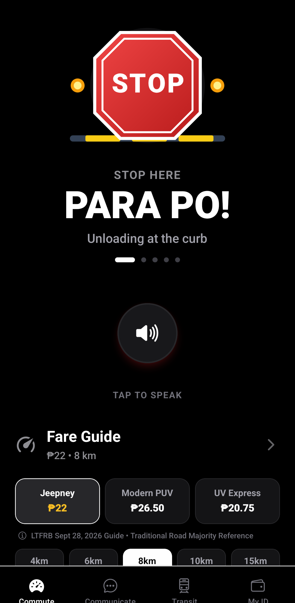
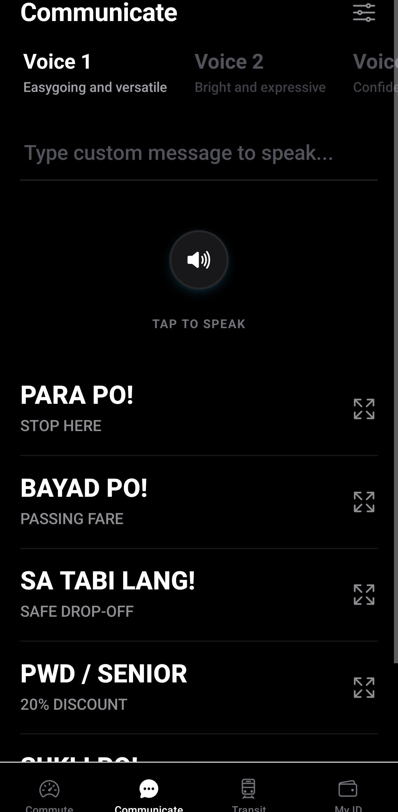
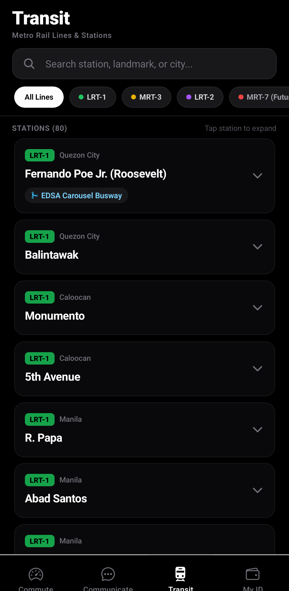
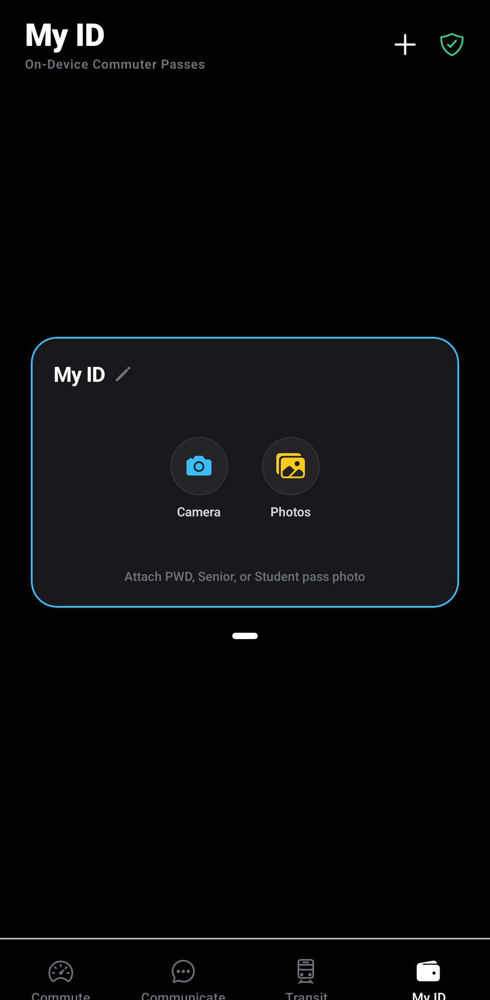

# Alalay 🚆✨

> **Accessible Philippine Commuter Companion for Commuters & PWDs**  
> Designed with a Tesla-inspired minimalist open canvas, animated commuter flashcards, ChatGPT Voice Mode-inspired radiant orb, local natural Filipino text-to-speech, 100% offline Metro Manila Rail Transit Hub with fact-checked project timelines and operator accessibility directories, and private on-device ID storage.

---

## 📱 Visual Showcase

<div align="center">
  <table>
    <tr>
      <td align="center" width="25%">
        
        <br />
        <b>1. Commute & Fare Guide</b>
      </td>
      <td align="center" width="25%">
        
        <br />
        <b>2. Communicate & Voice</b>
      </td>
      <td align="center" width="25%">
        
        <br />
        <b>3. Transit Directory</b>
      </td>
      <td align="center" width="25%">
        
        <br />
        <b>4. My ID (Private On-Device)</b>
      </td>
    </tr>
  </table>
</div>

---

## 📌 Table of Contents

1. [About The Project](#-about-the-project)
2. [Key Features](#-key-features)
3. [Software Engineering & Dependable Design (Sommerville 10th Ed.)](#-software-engineering--dependable-design-sommerville-10th-ed)
4. [Architecture & Tech Stack](#-architecture--tech-stack)
5. [Project Structure](#-project-structure)
6. [Getting Started](#-getting-started)
    - [Prerequisites](#prerequisites)
    - [Installation](#installation)
    - [Running Development](#running-development)
    - [Building Standalone Release APK](#building-standalone-release-apk)
7. [UI/UX & Design Philosophy](#-uiux--design-philosophy)
8. [License](#-license)

---

## 📖 About The Project

Public transport in the Philippines (jeepneys, modern PUVs, UV Express, buses, and trains) relies heavily on fast-paced verbal cues (*"Para po!"*, *"Bayad po!"*, *"Sukli po!"*) and crowded curbside interactions. For **Persons with Disabilities (PWDs)**—particularly deaf, hard-of-hearing, speech-impaired, or mobility-challenged commuters—navigating public transport can be stressful and exclusionary.

**Alalay** bridges this accessibility barrier. Built with an unboxed, pitch-black aesthetic inspired by modern automotive software, Alalay combines:
- **Instant Full-Bleed Animated Visual Cards** to communicate passenger intent across crowded vehicles with zero visual clutter.
- **Local Natural Filipino Text-to-Speech** with prosody-normalized Filipino pronunciation and inclusive voice profiles.
- **Radiant Voice Mode Orb** featuring pulsing multi-layered harmonic auras, tactile haptic feedback, and glowing uppercase text highlights.
- **100% Offline Transit Hub** covering the complete Metro Manila rail network (LRT-1 Cavite Extension, LRT-2, MRT-3, MRT-7, Metro Manila Subway MRT-9) with timetables, fares, operator PWD hotlines, and 1-tap native turn-by-turn GPS intents.
- **LTFRB Fare Guide & Offline Calculator** providing accurate fare computation for PUJs, Modern PUVs, and UV Express with simplified 20% discounts for PWDs, Seniors, and Students.
- **User-Controlled On-Device ID Storage** with standard CR80 aspect ratio cards (`1.586:1`), horizontal peeking carousel, camera capture, photo gallery attachment, and full-screen inspector modal with double-tap zoom.

---

## 🚀 Key Features

### 🎴 1. Commute: Fare Guide & Quick Cards
- **Official LTFRB General Fare Guide (Effective September 28, 2026):** Verified directly from the official LTFRB Google Drive repository matrices:
  - **Traditional PUJ (Jeepney):** **₱14.00** base (first 4.0 km) + **₱2.00** per succeeding km (20% Discount: **₱11.25** base + **₱1.60**/km).
  - **Aircon Modern & Electric PUJ (Modern PUV):** **₱17.00** base (first 4.0 km) + **₱2.40** per succeeding km (20% Discount: **₱13.50** base + **₱1.92**/km).
  - **Traditional UV Express:** **₱2.60** per kilometer flat rate (20% Discount: **₱2.08**/km).
- **Road Majority Transparency Standard:** Clear disclosure across the UI that Traditional PUJ and Traditional UV Express serve as the primary baseline reference, reflecting the vast majority of vehicles operating on Philippine roads.
- **Official 25-Centavo Rounding:** Enforces LTFRB's statutory rounding policy (*"Fares are rounded off to the nearest 25 centavos"* via `Math.round(raw * 4) / 4`).
- **Dynamic Vehicle Fare Computation:** Jeepney, Modern PUV, and UV Express buttons dynamically update displayed fares in real-time as distance presets (4km, 6km, 8km, 10km, 15km) or the 20% discount toggle are selected.
- **Native Offline LTFRB Rate Table Modal:** Replaces webviews that fail behind Cloudflare bot challenges with a 100% offline native matrix table covering 1 km to 25 km, active distance highlighting, and 1-tap dialer for LTFRB 24/7 Hotline `1342`.
- **Plain-Language 20% Discount:** One-tap toggle for the official 20% discount (PWD, Senior, Student)—written in simple, welcoming English rather than alienating legal jargon.
- **100% Hands-Free Clean Geometric Vector Illustrations:**
  - 🛑 **`PARA PO!`:** Illuminated geometric transit STOP octagon with curbside striping and flashing amber hazard beacons.
  - 💵 **`BAYAD PO!`:** Crisp Philippine Peso banknote with authentic security seal and golden coins gliding forward with velocity chevrons.
  - 🪙 **`SUKLI PO!`:** Pure grounded stack of authentic Philippine Peso coins (bimetallic ₱20, bimetallic ₱10, ₱5 gold, ₱1 silver) with realistic metallic luster, zero floating trails, and zero artificial trays or dish containers.

### 🎙️ 2. Communicate: Voice Prompts & Voice Orb Mode
- **Radiant Celestial Orb:** Voice mode orb inspired by modern conversational AI, featuring 3 concentric pulsing aura layers and fluid frequency spectrum bars.
- **Full-Screen Card Presentation:** Tap any communication prompt to instantly display a high-contrast card visible across the vehicle cabin.
- **Inclusive Neutral Voice Profiles:**
  - `Voice 1` – Balanced & friendly (Default)
  - `Voice 2` – Warm & expressive
  - `Voice 3` – Confident & articulate
- **Custom Commuter Speech:** Custom text-to-speech input field to speak any message aloud through on-device neural TTS engines.

### 🚆 3. Transit: Metro Manila Rail Directory
- **Zero Web Latency & 35MB RAM Savings:** Replaced heavy, laggy WebViews with a native, instant 60/120 FPS rail transit directory that works completely without internet access.
- **Fact-Checked Line Coverage & Timelines:**
  - **LRT-1 (Green Line):** 25 stations from Fernando Poe Jr. (Roosevelt) through Cavite Extension Phase 1 (Redemptorist - MIA - Asia World/PITX - Ninoy Aquino - Dr. Santos).
  - **LRT-2 (Purple Line):** 13 stations from Recto to Antipolo.
  - **MRT-3 (Yellow / EDSA Line):** 13 stations from North Avenue to Taft Avenue.
  - **MRT-7 (Northeast Line - Under Construction):** 14 stations connecting North Avenue to San Jose del Monte. Verified target: Partial operations to Sacred Heart in Q2 2027; full corridor in 2028.
  - **Metro Manila Subway / MRT-9 (Under Construction):** 15 underground stations from East Valenzuela to NAIA Terminal 3. Verified target: Demonstration run in Q1 2028; full corridor in 2031–2032.
- **Accessibility Truth & Operator Hotlines:** Rather than guessing elevator availability, stations list operator-verified accessibility features alongside direct 1-tap dialable operator assistance hotlines:
  - LRMC (LRT-1): `(02) 5318-5777`
  - LRTA (LRT-2): `(02) 8647-3452`
  - MRT-3: `(02) 8929-5347`
- **1-Tap Native Turn-by-Turn GPS Navigation:** Launches real turn-by-turn navigation via `google.navigation:q={lat},{lng}` directly into the native Google Maps app with automatic fallbacks.

### 🪪 4. My ID: 100% Private On-Device Card Vault
- **Standard CR80 Ratio & Peeking Carousel:** ID cards are formatted to standard ID-1/CR80 credit-card proportions (`1.586:1`), snapping smoothly horizontally while peeking adjacent cards at the screen edges.
- **User-First Control (Anti-Template):** No fake synthetic templates, barcodes, or mock badges. Commuters have complete ownership:
  - Take a photo of an official PWD, Senior, or Student ID card via Camera.
  - Attach an existing photo from the Photo Gallery.
  - Rename cards inline via floating name pill.
  - Tap any card for full-screen zoom, inspection, and presentation to conductors.
- **Tesla/Apple-Style Privacy Bottom Sheet:** Elegant slide-up card explaining:
  - *"Stored Only on Your Device: Photos are kept strictly in local offline sandbox storage. Never uploaded online or to any cloud."*

---

## 🛡️ Software Engineering & Dependable Design (Sommerville 10th Ed.)

Alalay was architected against the software engineering principles outlined in **Ian Sommerville's *Software Engineering* (10th Edition)**:

```
+--------------------------------------------------------------------------+
|                     ALALAY ARCHITECTURAL DEFENSE                         |
+--------------------------------------------------------------------------+
|  Part 1: Secure Systems Design                                           |
|  - Principle of Least Privilege: Sandboxed FileSystem storage            |
|  - Zero Web Attack Surface: 100% offline native transit hub              |
|  - Input Sanitization: Trimmed & clamped search queries & card names     |
+--------------------------------------------------------------------------+
|  Part 2: Dependable Programming                                          |
|  - Multi-Tier Intent Fallback (google.navigation -> geo: -> web URL)     |
|  - Storage Lifecycle Garbage Collection (Orphan photo deletion)          |
|  - Strict TypeScript Static Typing & Zero-Crash Error Boundaries         |
+--------------------------------------------------------------------------+
|  Part 3: Resilience Engineering                                          |
|  - 100% Offline Survivability (Zero remote API or server dependency)     |
|  - Multi-Modal Redundancy (Full-screen visual cards if audio muted/off)  |
|  - Android 15 Edge-to-Edge Adaptive Insets (No gesture pill collision)   |
+--------------------------------------------------------------------------+
```

### Part 1: Secure Systems (Secure Design)
- **Asset Protection & Compartmentalization:** User ID documents and discount passes contain sensitive personal information. Rather than relying on external cloud databases, photos are saved into `FileSystem.documentDirectory` using isolated cryptographic timestamp filenames.
- **Zero Web Surface:** By deprecating in-app WebViews in favor of native data arrays, Alalay completely eliminates XSS, credential exfiltration, session cookie leakage, and arbitrary DOM execution vulnerabilities.
- **Defensive Input Handling:** All station search queries and card names undergo strict character sanitization, stripping newlines, control characters, and regex operators, with length clamped to prevent buffer or render stalls.

### Part 2: Dependable Programming
- **Fault Avoidance & Defensive Fallbacks:** Deep linking out to native GPS apps uses a 3-tier fallback strategy:
  1. `google.navigation:q=lat,lng` (Native Android Google Maps Turn-by-Turn GPS mode).
  2. `geo:lat,lng` (System-wide map coordinator intent).
  3. Safe parameterized HTTPS Google Maps web URL.
- **Lifecycle Cleanup & Garbage Collection:** When a user removes or deletes an ID card, the associated file in local disk storage is deleted idempotently to avoid disk leakage and storage pollution over time.
- **Strict Typing:** All rail lines, stations, interchange nodes, and card structures enforce complete TypeScript type safety with zero `any` mutations.

### Part 3: Resilience Engineering
- **Graceful Degradation:** If on-device text-to-speech fails, is uninstalled, or is muted, flashcards maintain 100% functional utility via high-contrast visual scenes and full-screen takeover modes.
- **Offline Survivability:** The app operates in complete isolation from the network. Transit station data, fare matrices, and flashcards function identically with or without cellular connectivity.
- **Edge-to-Edge Gesture Inset Safety:** On modern Android 15 devices (Nothing Phone, Pixel, Samsung), system gesture pills overlap bottom navigation tabs if static padding is used. Alalay dynamically measures `useSafeAreaInsets().bottom` (`Math.max(insets.bottom, 16)`) ensuring the tab bar is elevated with full touch ergonomics.

---

## 🛠️ Architecture & Tech Stack

- **Framework:** [Expo SDK 54](https://expo.dev/) / [React Native 0.79](https://reactnative.dev/) (New Architecture Enabled)
- **Styling:** [NativeWind v4](https://www.nativewind.dev/) (Tailwind CSS for React Native)
- **Navigation:** [Expo Router v4](https://docs.expo.dev/router/introduction/) (File-based typed routes)
- **Icons:** `@expo/vector-icons` (Ionicons)
- **Audio & Speech:** `expo-speech` with custom phonetic prosody normalization
- **Haptics:** `expo-haptics` (Contextual impact and notification feedback)
- **Camera & Storage:** `expo-image-picker` & `expo-file-system`
- **Target Device Tested:** Nothing Phone (3a) Pro (`model A059P`, Android 15, Nothing OS 3.0)

---

## 📂 Project Structure

```
D:\Dev\projects\alalay\
├── android/                   # Native Android project (Gradle, AndroidManifest)
├── app/
│   ├── (tabs)/
│   │   ├── _layout.tsx        # Bottom tab bar (Commute -> Communicate -> Transit -> My ID)
│   │   ├── index.tsx          # Tab 1: Commute (Quick Cards, PUV Fare Calculator)
│   │   ├── VoicePromptsTab.tsx# Tab 2: Communicate (Flashcards & Voice Mode Orb)
│   │   ├── WebMapTab.tsx      # Tab 3: Transit (LRT-1, LRT-2, MRT-3, MRT-7, Subway)
│   │   └── IDCardTab.tsx      # Tab 4: My ID (CR80 Peeking Carousel, Camera, Gallery)
│   ├── data/
│   │   └── transitLines.ts    # Comprehensive Metro Manila Rail Stations, Schedules & Hotlines
│   ├── logic/
│   │   ├── useCommute.ts      # Fare calculator & quick commuter card state
│   │   ├── useIdCard.ts       # Secure on-device ID photo & storage management
│   │   ├── useVoicePrompts.ts # TTS speech synthesis & voice profile logic
│   │   └── fareCalculators.ts # LTFRB PUV fare calculation matrices
│   └── _layout.tsx            # Root layout & gesture navigation providers
├── assets/
│   └── images/                # Alalay brand emblem, adaptive icons & splash screens
├── components/
│   ├── FlashcardScene.tsx     # Custom animated flat-vector commuter scenes
│   └── VoiceOrb.tsx           # Multi-layered celestial glowing voice mode orb
├── docs/
│   └── screenshots/           # High-resolution screenshots from Nothing Phone (3a) Pro
├── scripts/
│   └── generate_brand_assets.py # Brand icon & splash screen generation script
├── AGENTS.md                  # Autonomous pair programmer rules & guardrails
└── README.md                  # Comprehensive project documentation
```

---

## 🚀 Getting Started

### Prerequisites
- Node.js (v22.x LTS recommended)
- JDK 17 (Eclipse Adoptium OpenJDK 17)
- Android SDK (`ANDROID_HOME` configured with platform-tools & build-tools 35.0.0)
- Physical Android device or Android Virtual Device (AVD)

### Installation
```bash
# Clone the repository
git clone https://github.com/reskydevs/alalay.git
cd alalay

# Install dependencies
npm install
```

### Running Development
```bash
# Start Metro bundler
npx expo start
```

### Building Standalone Release APK
```powershell
# Set environment paths (Windows PowerShell)
$env:PATH = "C:\Windows\System32;" + $env:PATH
$env:JAVA_HOME = "C:\Program Files\Eclipse Adoptium\jdk-17.0.17.10-hotspot"
$env:ANDROID_HOME = "D:\Dev\ToolData\Android-Sdk"

# Build standalone APK (Optimized: 16 worker threads, lint bypass, arm64-v8a target: ~4m 52s)
cd android
.\gradlew.bat assembleRelease
```

### Installing on Device via ADB
```powershell
# Install release APK onto target device
& "D:\Dev\ToolData\Android-Sdk\platform-tools\adb.exe" -s 00170155D000432 install -r "android\app\build\outputs\apk\release\app-release.apk"

# Launch Alalay
& "D:\Dev\ToolData\Android-Sdk\platform-tools\adb.exe" -s 00170155D000432 shell monkey -p com.reskydevs.alalay -c android.intent.category.LAUNCHER 1
```

---

## 🎨 UI/UX & Design Philosophy

1. **Unboxed Open Canvas (Tesla-Inspired):**
   Pure pitch-black (`#000000`) background eliminates visual boxiness and reduces OLED battery drain on mobile screens.
2. **Frameless Iconography:**
   Icons directly convey affordances without being trapped inside unnecessary rounded rectangles or circular button borders.
3. **High-Contrast Commuter Typography:**
   Minimalist headers with prominent uppercase keywords readable from meters away inside a rattling jeepney or crowded train.
4. **Haptic & Visual Symbiosis:**
   Every touch triggers tactile haptic pulses (`expo-haptics`) paired with glowing voice animations and fluid spring transforms.

---

## 📄 License

Distributed under the MIT License. See `LICENSE` for more information.
